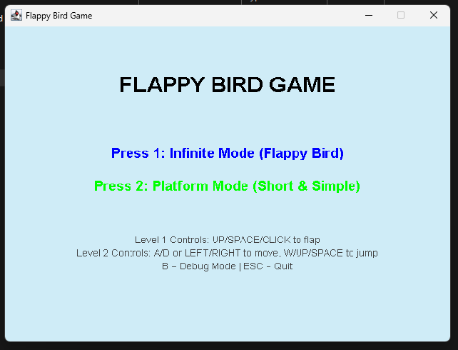
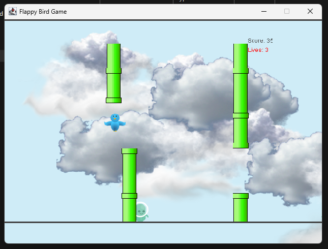

# Flappy Bird 2D (Java Game)

A 2D retro-style Flappy Bird game built in Java with Swing/AWT, custom animation sprites, procedural pipe generation, sound effects, and multiple game modes.

---

## 📸 Screenshots

| Main Menu | Gameplay (Infinite Mode) |
| :---: | :---: |
|  |  |

---

## 🎮 Game Modes

* **Level 1 — Infinite Mode**:
  * Fly through procedurally generated pipe obstacles.
  * Avoid ground-patrolling creatures between pipes.
  * Collect points the further you advance.
* **Level 2 — Platform Mode**:
  * Faster paced with higher gravity and sunset backdrop.
  * Dodge falling penguins and ground hazards.

---

## 🕹️ Controls

| Action | Keys / Mouse |
| :--- | :--- |
| **Select Level** | `1` (Infinite Mode) / `2` (Platform Mode) |
| **Flap / Jump** | <kbd>Space</kbd> / <kbd>▲ Up</kbd> / <kbd>W</kbd> / **Left Click** |
| **Caw Sound** | <kbd>S</kbd> |
| **Toggle Debug Boxes** | <kbd>B</kbd> |
| **Restart (Game Over)** | <kbd>Space</kbd> / **Left Click** |
| **Return to Menu** | <kbd>M</kbd> |
| **Quit Game** | <kbd>Esc</kbd> |

---

## 🚀 How to Run

### Quick Start (Windows)
Double-click **`run.bat`** in this folder.

### From Command Line
Make sure you have JDK 8+ installed:

```bash
javac -d bin -sourcepath src src/Game.java
java -cp bin Game
```
